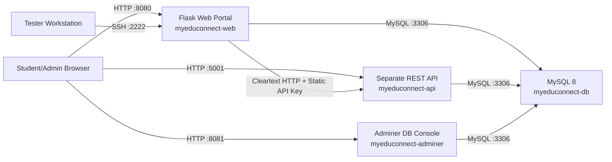

# Architecture

## Component Diagram

## Network Layout

| Host/Container | Exposed Port | Internal Port | Role |
|---|---:|---:|---|
| `myeduconnect-web` | `8080` | `8080` | Main learning portal |
| `myeduconnect-web` | `2222` | `22` | SSH service with weak credentials |
| `myeduconnect-api` | `5001` | `5001` | Separate REST API component |
| `myeduconnect-db` | `3306` | `3306` | MySQL database |
| `myeduconnect-adminer` | `8081` | `8080` | Exposed DB admin panel |

## Assignment Fit

- The web portal simulates MyEduConnect's online learning platform.
- The API service is the required additional component beyond the website.
- The MySQL service provides the backend database.
- Docker Compose provides a redeployable hosting setup for the instructor.
- Cleartext HTTP between `web` and `api` supports the required network-layer issue.
